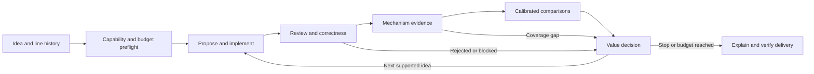

# Swap Next research-loop audit and proposed revision

Status: approved by the owner on 2026-11-02 for framework implementation
(stages 1-4). The real pilot in stage 5 remains separately authorized.
The audit below describes the pre-implementation state.
Audited source: `a753cf31a4d7b7f558f73e9bcca4baf33275c02c`.
Frozen campaigns retain their original scientific inputs. Implementation and
validation are tracked in the companion delivery record.

## Verdict

Keep the evaluator, isolated candidates and evidence machinery. Extend them
into a durable, idea-driven research workflow that any contributor agent can
operate through `closed-loop-evolve`. The current implementation supplies
reliable experimental primitives, but leaves orchestration, research value,
review dispositions and report delivery substantially to the current assistant.

The unit of work is a bounded research campaign, not a calendar day or a quota
of small patches. A valuable outcome can be a useful redesign, a simpler
equivalent implementation, a rejected idea, or evidence that the benchmark
cannot answer the question.

Chris's feedback becomes two explicit requirements:

- A performance result must justify the additional semantic and maintenance
  complexity. Equal performance with substantially simpler code can be a win.
- Relevant upstream alternatives must be measured under the same comparison
  protocol before claiming that our approach is worth pursuing.

## Evidence and audit findings

Source locators below refer to the audited commit. Confidence is high for the
implementation findings; the proposed remedies are design judgments.

| Priority | Finding | Evidence | Consequence |
| --- | --- | --- | --- |
| P1 | Review rejection does not reliably revoke parent eligibility. | `evolve/population.py:216-228,384-400`; `evolve/control/controller.py:607-616`; retained rev7 example below. | An agent can inherit an unresolved correctness problem despite a written review warning. |
| P1 | There is no durable start-to-delivery action driver. | `evolve/standard_workflow.py:800-875`; `controller.py:338-343`. `next` emits a brief; `new` returns `PREPARED_ONLY`. | The skill can guide an assistant through the loop, but completion depends on that assistant reconstructing and remembering the procedure. |
| P1 | Campaign closure does not record report completion or delivery. | `controller.py:529-548`; `.agents/skills/explaining-campaign-results/SKILL.md:87-105`. | A closed campaign can still need extraction, explanation, visual verification and publication. |
| P1 | The fixed scope and probe contract privilege a narrow class of improvements. | `evolve/control/config/policy.json:9-23`; `controller.py:168-187`; `benchmark/swap-standard/probe.py:113-144`; `standard_workflow.py:131-157`. | Some architecture changes are out of scope; reducing work per event can fail a probe that insists on changing the event count. |
| P1 | Upstream comparison is not a first-class experiment input. | `standard_workflow.py:584-593,631-632,659-681`. `reference-check` uses the baseline for both arms. | A local speedup does not answer whether a relevant upstream alternative is simpler or better. |
| P2 | Selection has no explicit practical-value or complexity decision. | `evolve/population.py:85-119,236-251`. OpenEvolve receives `combined_score`; advancement uses calibrated noise and scored guards. | A tiny gain with new ownership or locking obligations can look attractive; simplification has no named success path. |
| P2 | Lines are histories rather than durable research agendas. | `evolve/control/lines.py:57-118`; `evolve/population.py:443-500`. | Questions, alternative mechanisms, retirement decisions and cumulative research spending stay mostly in prose. |
| P2 | Recovery protects evidence but cannot finish an interrupted tier. | `standard_workflow.py:215-228,572-579,598-606`; `controller.py:496-521`. | Ownership can resume, while an abandoned evaluation becomes final/incomplete and duplicate-tier protection blocks continuation. |
| P2 | Preflight and allowed-tier enforcement are incomplete for a one-entry workflow. | `controller.py:253-271` always returns runtime not ready; `standard_workflow.py:803-804,610-611,864-865` describes slow approval but does not bind an approval receipt. | A generic doctor cannot tell a contributor which approved next action is executable; an automatic driver needs explicit allowed tiers. |
| P2 | Current documentation includes stale campaign status. | `README.md:48-51` calls revision 6 unopened; its campaign is closed and revision 7 is recorded open. | Entry documentation can send a new contributor to historical preparation rather than current state. |

### Concrete review-to-population discrepancy

The rev7 candidate record
[`v2-c1-xs-sync-ra`](https://github.com/ericzhang-zxh/Swap-Next/blob/a753cf31a4d7b7f558f73e9bcca4baf33275c02c/campaigns/xswap-tcg-kbench-rev7-2026-10-29/candidates/v2-c1-xs-sync-ra.json)
says that the review found an open SIGBUS TOCTOU and that it must not be a
parent. Its retained
[population entry](https://github.com/ericzhang-zxh/Swap-Next/blob/a753cf31a4d7b7f558f73e9bcca4baf33275c02c/campaigns/xswap-tcg-kbench-rev7-2026-10-29/archive/population.json)
has no invalidations and retains a fast pass. The second
[durable brief](https://github.com/ericzhang-zxh/Swap-Next/blob/a753cf31a4d7b7f558f73e9bcca4baf33275c02c/campaigns/xswap-tcg-kbench-rev7-2026-10-29/archive/briefs/brief-000002-2db0c4104afa.json)
sampled that candidate and permitted commit `31eb4618eae83f8ff55e4201b55bfe54a1d84284`.

This reproduces the mismatch at the archived `dcca47b0...` fingerprint.
The successor c1c actually selected the baseline. Present-day eligibility on a
different runtime fingerprint was not asserted. A structured, enforced review
veto covering this path would overturn the finding.

The same historical fast pass has an advisory p99 regression. The evaluator
honored that frozen protocol's advisory setting; this is a limitation in how
results influence research decisions, not a scored-guard enforcement bug.

## Preserve the useful foundation

Retain immutable commit/tree and protocol identities, cumulative diff checks,
isolated candidate worktrees, exact-parent sampling receipts, calibrated
comparisons, counted single-use guest reservations, machine ownership, STOP and
deadline checks, negative evidence and human-only code promotion.

The October 27 campaign-directory, probe and inheritance work remains useful.
Its follow-up review already identified probe coverage and baseline-advancement
limits. This revision addresses the next layer rather than repeating that work.

## Research model

Use three existing concepts more explicitly:

1. **Line:** a persistent research question with an original anchor, current
   evidence-backed baseline, competing explanations, relevant upstream
   alternatives, objective, scope/measurement profile and continuation criteria.
2. **Campaign:** one bounded attempt to learn or improve on a selected line,
   with frozen measurement inputs and an explicit resource budget.
3. **Candidate:** an isolated implementation of a falsifiable idea, with an
   exact parent and a change type: optimize, simplify, redesign or repair.

A line may contain a branching candidate history rather than a single
hill-climbing chain. Rejected ideas remain searchable negative evidence.
Neutral parents can remain exploratory only when the expected learning value,
review disposition and additional budget are explicit.

Keep `campaigns/lines/<line>.md` generated. Add a small authoritative
`campaigns/lines/<line>.json` for the research question, prioritized ideas,
references and decisions; derive spending from existing campaign ledgers.
Do not create another source of truth for guest counts or results.

Multiple lines can coexist. At campaign start, select a line based on expected
learning/value, unresolved blockers and available resources, recording why.
One active campaign per measurement machine remains the simple default.
The first implementation need not interleave multiple lines inside a campaign,
create a cluster scheduler, or maintain a global cross-protocol leaderboard.
A new campaign must not erase an exhausted line-level resource ceiling.

An idea records: observed bottleneck; proposed mechanism; affected path;
expected user-visible benefit; simpler alternative; upstream comparator;
complexity/risk delta; required evidence; falsifier; estimated evaluation cost.

## One contributor entry, durable next actions

The contributor-facing entry remains `closed-loop-evolve`, with Start and
Resume behavior. The current agent supplies research reasoning and edits;
trusted project code supplies state transitions, measurements and evidence.
An active compatible agent session is required. This is not a promise of a
background daemon surviving the disappearance of the agent runtime.

Proposed interface, not a command that exists today:

```text
closed-loop-evolve start [idea or line]
closed-loop-evolve resume <campaign>
```

The entry resolves the selected line, an approved scope/measurement profile,
the machine and the bounded budget. Missing routine values come from approved
defaults. A genuinely new scope, measurement capability or consequential
resource request becomes one concrete blocked decision after independent
preparation is complete.

The durable action sequence is:



Each action has a stable ID, input identities, expected evidence, allowed
effects and terminal result. Persist it in the existing campaign state before
execution. After interruption, reconcile artifacts and owned processes before
choosing the next action. Do not use chat history as the only checkpoint.

Separate three decisions in stored state:

- **Scientific result:** valid/incomplete, mechanism observation, fast screen,
  regressions and uncertainty.
- **Research disposition:** rejected, exploratory, worthwhile-to-confirm,
  simplification, or review-blocked.
- **Delivery state:** pending, generated, visually checked, published and
  live-verified, or blocked with the exact unresolved action.

Keep execution closure independent from delivery. Once experiments end, release
the measurement machine; closeout remains resumable. A finished Start invocation
returns a verified report or a concrete delivery blocker. STOP and exhausted
guest budgets still permit authorized reporting.

### Review and recovery semantics

A structured review disposition must bind candidate tree, review evidence and
scope of the finding. An unresolved correctness finding immediately blocks
parent selection, baseline advancement and further dependent execution.
Closing the candidate with prose is insufficient. Existing briefs are checked
again at use time; descendants carrying the affected code are quarantined until
their own exact-tree review resolves it. Preserve original reports and outcomes.

Recovery may continue only unlaunched arms of a frozen schedule when the
protocol explicitly permits it and elapsed-time/environment rules still hold.
Launched or ambiguous attempts remain counted; they are reconciled, never
quietly rerun. If interrupted pairs are scientifically unusable, close the
result as incomplete and plan a new approved measurement. Resume must not become
a way to cherry-pick samples.

## Make benefit justify complexity

Do not collapse maintenance cost into an invented speed-minus-lines score.
Record both incremental parent-to-child and cumulative baseline-to-candidate
complexity. Review these concrete obligations:

- New state, special cases and ownership/lifetime transitions.
- Additional lock ordering, atomic or RCU reasoning.
- Allocation/error/unwind paths, memory and cache costs.
- New tuning knobs, interfaces and supported configuration combinations.
- Test coverage needed, failure diagnosis and expected upstream review burden.

Line count is useful context, not the decision rule. Prefer candidates on a
benefit/complexity frontier: a simpler candidate with similar benefit can
dominate a more complex one. Among eligible frontier candidates, numerical
scores may still help sampling; keep the reason for exploring an exception.

Before measurement, the line's profile defines the smallest useful effect,
important workload/tail regressions, and how a simplification can qualify.
Statistical detectability and practical value are separate questions.
A small uncertain gain plus substantial new complexity should normally stop.
Equivalent performance with fewer states or simpler invariants can continue.

Fast evidence supports screening and choosing the next experiment. Independent
confirmation is needed for a confirmed performance claim after adaptive search.
Existing slow-tier approval rules remain in force; the automatic default stops
at the authorized screen and reports candidates worth confirming.

## Measure upstream alternatives as experimental arms

Choose relevant alternatives from primary upstream discussions, patches and
commits when preparing the campaign. Pin series revision, dependencies,
application base, resulting tree and source URL. Literature numbers supply
context; they are not measurements under our protocol.

Where compatible, use a common frozen base B:

| Arm | Purpose |
| --- | --- |
| B | Fixed control |
| B + P | Relevant upstream patch/series P |
| B + C | Our candidate C |
| B + P + C | Optional composition; does C add value after P? |

If C already builds on an inherited experimental baseline, explicitly record
that complete stack. Do not label a patched incumbent as pristine upstream.
A root-line anchor and a same-campaign baseline serve different purposes.

Use the same machine, accelerator, configuration, workload and predeclared
pair/block ordering for each contrast. Include control repetition, correctness
coverage and comparison arms in the budget before launching. Report pairwise
effects with units, uncertainty and failed guards, not a ratio assembled from
unrelated historical runs.

If P and C cannot share a valid base, record the conflict and either create a
reviewed common-base comparison or report contextual results as incomparable.
An incompatible alternative is not silently assigned a zero benefit.
The optional composition arm is justified by a concrete interaction question;
not every candidate needs every possible upstream patch.

The report should answer: Does C solve the problem? Is it worthwhile against B?
How does it compare with P? Does it add anything after P? What complexity and
regression costs pay for the benefit?

## Allow meaningful large and small changes

Replace one universal candidate shape with reviewed profiles, for example
swap-core tuning, metadata/representation redesign, or reclaim interaction.
Each profile specifies allowed files/interfaces, primary endpoint, correctness
matrix, trusted instrumentation, comparison cases and resource caps.

Existing frozen protocols keep their rules. New profiles are approved framework
changes; candidate workers cannot expand their own scope or edit evaluators.

Mechanism evidence can be a counter shift, per-operation cost, lock/trace
observation, state invariant or reviewed structural argument. The evidence type
and falsifier are declared before measurement. Structural evidence supports the
mechanism story; it does not replace runtime correctness or performance evidence.
An unavailable observable yields a coverage gap and a separate instrumentation
task, not a false rejection or a fabricated success.

## Reports are a product of the loop

Reuse the approved explaining-campaign-results renderer and three-level visual
standard: verdict, motivation, whole-system location, concrete before/after,
measurements and next decision. Derive numerical content from the same evidence
used by selection. The agent supplies the explanation and diagrams, with
provenance attached to claims.

Every report includes the research question, actual changes, upstream
comparisons, benefit/complexity decision, rejected attempts, missing coverage,
remaining resources and whether anything is running. Store extraction inputs,
generator, visual verification and delivery receipt so recovery can finish
without recreating the experiment.

Publication follows the standing repository policy. A failed publication remains
a delivery failure with a resumable action; it does not change the scientific
verdict. Candidate promotion remains a separate human decision.

## Implementation sequence and acceptance

| Order | Change | Acceptance evidence |
| --- | --- | --- |
| 1 | Structured review veto and eligibility reconciliation. | A fixture reproducing rev7 removes the candidate from sampling, advancement and stale briefs; descendants are checked; history stays intact. |
| 2 | Durable next-action and closeout state using current controller/workflow. | One skill invocation reaches a report from fixtures; interruption at each stage resumes without duplicate guest reservations, reset budgets or omitted delivery. |
| 3 | Line agenda, complexity/value decisions and upstream-arm contract. | The workflow can reject an unattractive micro-optimization, retain an equivalent simplification and produce a valid same-base upstream comparison. |
| 4 | Approved scope/measurement profiles and capability-aware preflight. | A structural hypothesis is either executable with the correct coverage or blocked with the exact missing capability. Candidates cannot widen profiles. |
| 5 | A separately authorized bounded real pilot. | Reproducible calibration, exact correctness evidence, retained failed attempts, value decision and a verified explanatory report. |

Start with the first two items. Avoid a new orchestration framework, model
ensemble or large dashboard until the contributor path reliably reaches
delivery. Do not change a frozen campaign to test these new rules.

## Validation and limitations

This audit inspected current main, the October 27 design and review, controller,
workflow, population, probe, reporting contract and retained rev7 evidence.
Guest-free validation on hurricpc-wsl:
`evolve/.venv/bin/python -m unittest evolve.test_standard_workflow` passed
35 tests. The review/population mismatch was independently checked from the
candidate record, archive and durable brief.

No kernel build, guest, calibration or new campaign was launched. No current
performance claim was established. Rev7 remains recorded open on grok-cloud;
its live processes were not inspected there. No matching experiment process
was observed on hurricpc-wsl during the audit. Existing tests do not cover the
proposed design, and this draft does not change runtime behavior.

For each implementation finding, a working supported path or enforced state
transition that handles the cited case would change the conclusion. The first
implementation stage should convert the concrete discrepancies into regression
fixtures before changing behavior.

## External design references

- [AlphaEvolve, Google DeepMind](https://deepmind.google/blog/alphaevolve-a-gemini-powered-coding-agent-for-designing-advanced-algorithms/):
  useful precedent for variation, automated evaluation and retaining promising
  ideas. It does not prescribe our kernel safety or approval boundaries.
- [autoresearch research instructions](https://github.com/karpathy/autoresearch/blob/master/program.md):
  explicitly value simplicity alongside measured improvement. Its simplicity
  criterion was checked directly during this audit; the document is a moving
  upstream reference, not a frozen Swap Next policy.
